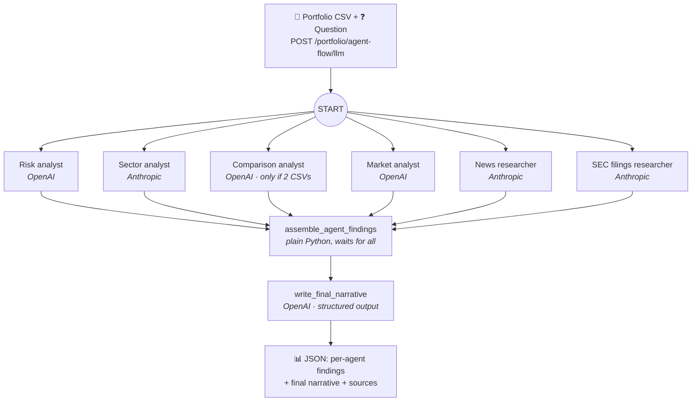
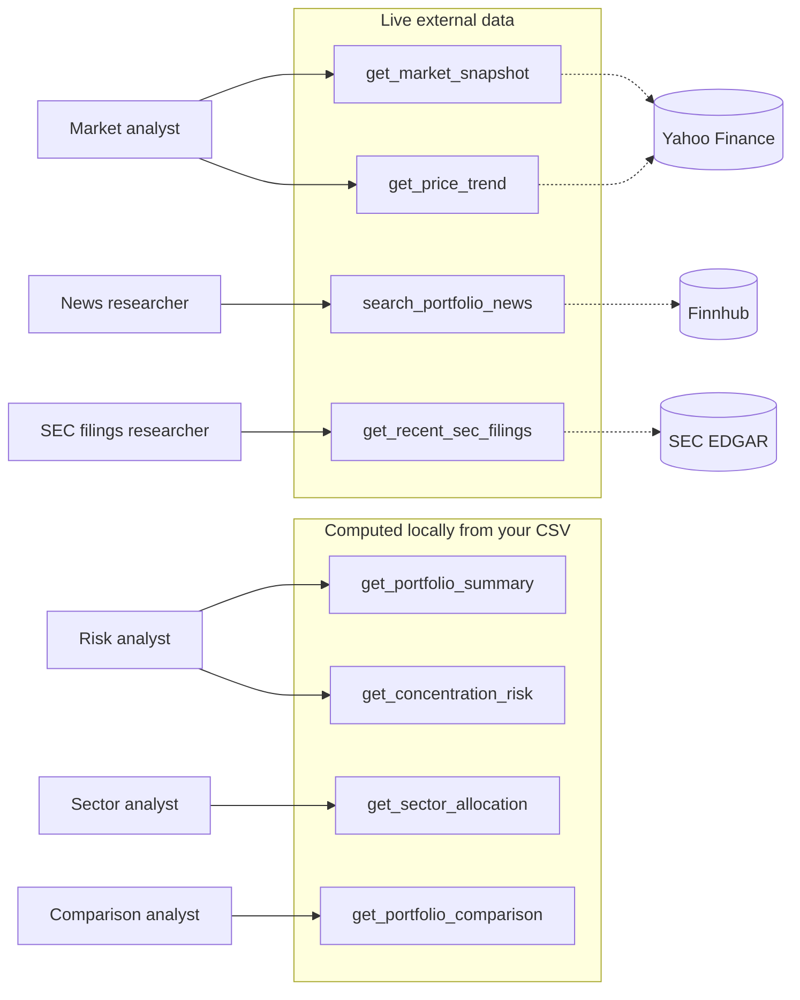
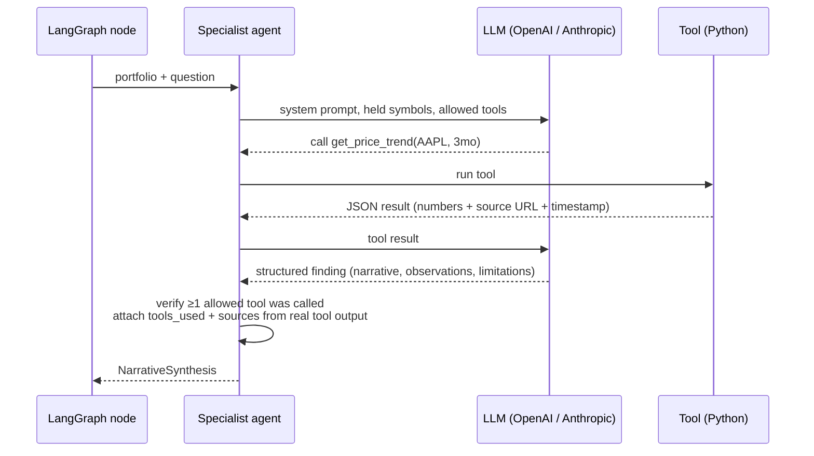

# Multi-Agent Investment Intelligence Platform

A backend that answers questions about an investment portfolio using a team of AI agents.
You upload a portfolio as a CSV, ask a question such as *"Where is my concentration
risk?"*, and six specialist agents investigate in parallel, three on OpenAI and three
on Anthropic. Each agent covers one area: risk, sectors, market prices, news, SEC
filings, and portfolio changes. A final OpenAI agent combines their findings into one
sourced answer.

**The core rule: the AI never does the math.** Every number (weights, returns,
concentration, drawdowns) is computed in Python by tools. The agents decide *which*
tools to call and *explain* the results. They cannot invent figures, and the citations
come from what the tools returned, not from the model.

> There is also a **deterministic workflow** (`POST /portfolio/agent-flow/deterministic`)
> that runs the same Python analytics with no LLM calls. It needs no API keys and is
> useful for demos and testing. The rest of this README covers the LLM workflow.

---

## How the LLM workflow works

The workflow is a [LangGraph](https://github.com/langchain-ai/langgraph) graph. All
specialists start at the same time, and a join step waits for every one of them before
the final narrative is written.



### Each agent only gets its own tools

Every specialist is the same class (`LangChainToolSelectingAgent`) configured with a
different model and a **scoped set of read-only tools**. An agent never sees tools
outside its area, and every tool rejects symbols that aren't in the uploaded portfolio.



| Agent | Model | Tools | Data source |
|---|---|---|---|
| Risk analyst | OpenAI | `get_concentration_risk`, `get_portfolio_summary` | Your CSV |
| Sector analyst | Anthropic | `get_sector_allocation` | Your CSV |
| Comparison analyst | OpenAI | `get_portfolio_comparison` | Two CSV snapshots |
| Market analyst | OpenAI | `get_market_snapshot`, `get_price_trend` | Yahoo Finance |
| News researcher | Anthropic | `search_portfolio_news` | Finnhub |
| SEC filings researcher | Anthropic | `get_recent_sec_filings` | SEC EDGAR |

### Inside one specialist

The model chooses tool calls, Python executes them, and the model writes a structured
finding. The code then checks the result before accepting it.



### Guardrails

- **No model math:** numbers come only from tool output; prompts forbid recalculating.
- **Must use evidence:** a finding is rejected if the agent didn't call one of its tools.
- **Citations from tools, not models:** `sources` are pulled from the actual tool
  results, so the model cannot fabricate URLs.
- **Portfolio-scoped:** tools only accept symbols present in the uploaded portfolio.
- **Honest failures:** if a source is down or rate-limited, the agent reports it under
  `limitations` instead of guessing.
- **No advice:** agents are instructed not to predict performance or recommend trades.

---

## Example

**Portfolio** (`sample_data/portfolio.csv`):

```csv
symbol,company,quantity,price,sector
AAPL,Apple,10,200.0,Technology
MSFT,Microsoft,8,300.0,Technology
XOM,Exxon,20,100.0,Energy
```

**Request:**

```bash
curl -X POST http://127.0.0.1:8000/portfolio/agent-flow/llm \
  -F "baseline_file=@sample_data/portfolio.csv" \
  -F "question=Where is my concentration risk?"
```

**Response** (trimmed from a real run):

```json
{
  "workflow": "llm",
  "agents": {
    "openai_risk":             { "tools_used": ["get_concentration_risk", "get_portfolio_summary"], "narrative": "..." },
    "anthropic_sector":        { "tools_used": ["get_sector_allocation"], "narrative": "...Technology accounts for 68.75%..." },
    "openai_market_research":  { "tools_used": ["get_market_snapshot"], "narrative": "..." },
    "anthropic_news_research": { "tools_used": ["search_portfolio_news"], "narrative": "..." },
    "anthropic_sec_filings":   { "tools_used": ["get_recent_sec_filings"], "narrative": "..." }
  },
  "final_narrative": {
    "headline": "Concentration Risk Assessment for Your Portfolio",
    "key_findings": [
      "68.75% of the portfolio is in Technology (AAPL + MSFT)",
      "MSFT is the largest position at 37.5% of total portfolio value",
      "XOM introduces geopolitical and legal risks",
      "Both AAPL and MSFT are exposed to AI and cloud computing thematic risks"
    ],
    "limitations": [
      "The news window is limited to 7 days; longer-term risks may not be reflected.",
      "No investment recommendations are made or implied."
    ],
    "sources": [
      { "source": "Yahoo Finance via yfinance", "url": "https://finance.yahoo.com/quote/AAPL/history/", "retrieved_at": "2026-10-12T22:56:23Z" },
      "... 24 sources in total (Yahoo Finance, Finnhub, SEC EDGAR)"
    ]
  }
}
```

The 68.75% and 37.5% figures were computed by Python tools. The agents only reported them.

---

## Running it

```bash
python -m venv .venv && source .venv/bin/activate
pip install -e ".[llm,research,dev]"
cp .env.example .env          # then fill in the keys below
uvicorn portfolio_ai.app:app --reload
```

Open **http://127.0.0.1:8000/docs** for interactive API docs.

| Variable | Needed for | Notes |
|---|---|---|
| `OPENAI_API_KEY` | Risk, comparison, market agents and final narrative | `OPENAI_MODEL` defaults to `gpt-4o-mini` |
| `ANTHROPIC_API_KEY` | Sector, news, filings agents | `ANTHROPIC_MODEL` defaults to `claude-sonnet-4-6` |
| `FINNHUB_API_KEY` | News agent | Free key at [finnhub.io](https://finnhub.io); ~60 requests/min |
| `SEC_USER_AGENT` | SEC filings agent | App name + contact email, required by SEC (e.g. `PortfolioAI you@example.com`) |

`.env` is git-ignored. Commit only `.env.example`.

Run the tests (no API keys needed; providers are stubbed):

```bash
pytest
```

## Project structure

```text
src/portfolio_ai/
├── app.py                       # FastAPI endpoints
├── llm.py                       # Specialist agents + final narrative writer
├── models.py                    # Portfolio data models
├── agents/portfolio_agent.py    # LangGraph workflows (deterministic + LLM)
├── analytics/portfolio.py       # Portfolio math: weights, sectors, risk, comparison
├── data/loader.py               # CSV loading and validation
└── tools/
    ├── portfolio_analysis.py    # Local tools (computed from the CSV)
    └── external_research.py     # Yahoo Finance, Finnhub, SEC EDGAR tools
```

## Tech stack

Python · FastAPI · Pydantic · pandas · NumPy · LangGraph · LangChain (`create_agent`) ·
OpenAI · Anthropic · yfinance · Finnhub · SEC EDGAR · pytest

## Limitations

- Market data via yfinance is unofficial and may be delayed or rate-limited.
- Finnhub news covers mainly US-listed companies; SEC EDGAR covers US public filers only.
- Each request makes several LLM calls, so it takes a while and costs a little each time.
- Output is informational, not financial advice. No trading or execution.

## Author

Developed by **Cesar Alba**.
